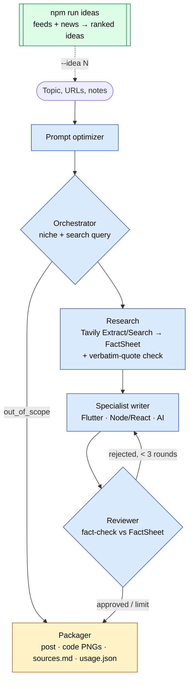

# Proofpost

**Research-grounded, fact-checked technical LinkedIn posts — from topic discovery to a ready-to-publish package.**

[](https://www.typescriptlang.org/)
[](https://github.com/langchain-ai/langgraphjs)
[](https://ai.google.dev/)
[](https://openrouter.ai/)
[](https://tavily.com/)

Proofpost is a multi-agent system built with **LangGraph.js** and **TypeScript** that turns a topic (or a link, or your own notes) into a technical LinkedIn post whose every specific claim — versions, API names, flags, numbers — is backed by a **verbatim quote from a real source**. It also suggests what to post next: three times a week it scans official release feeds and tech news, and hands you a short study guide for each idea so you can learn the topic before writing about it.

It was built for a concrete problem: writing an accurate post about a new release used to take me ~2 hours (finding sources, reading, drafting, writing and rendering code, double-checking facts). LLMs make drafting fast, but they confidently invent versions and APIs. Proofpost keeps the speed and removes the guessing.

> Publishing stays manual on purpose (human-in-the-loop): the system writes a local package — post, code images, sources — and you review and publish it.

---

## What it does

| | |
|---|---|
| **Topic discovery** | Reads official feeds (Node.js, React, Next.js, TypeScript, Vite, Flutter, Dart, LangGraph/LangChain, MCP, Google ADK, LiteRT…) and a weekly news search, removes what you already posted, and ranks 5–7 ideas — each with *what it is*, *why it matters*, 2–3 links to study and a suggested angle. Scheduled on macOS (launchd). |
| **Research, once per run** | Collects sources from your URLs, your pasted notes and/or a Tavily web search (social networks excluded), then builds a **FactSheet**: `{claim, source, verbatim quote, date}`. A deterministic check drops any fact whose quote does not literally appear in its source. |
| **Writing** | A domain specialist (Flutter/Dart, Node/React, AI engineering) writes from the FactSheet: specific technical claims are allowed **only** if they are in it. Quick (80–150 words) or in-depth posts. |
| **Fact-checking** | A reviewer from a **different model family** (Claude Sonnet) audits the draft against the same FactSheet and returns surgical corrections (exact wrong text → fix), up to 3 rounds. Without any source, the post is still produced but stamped **NOT VERIFIED**. |
| **Packaging** | Code snippets become syntax-highlighted PNGs, placeholders are reconciled with the images, and `sources.md` lists every source and quoted fact. |
| **Cost control** | Each role has its own model chain (Gemini direct → same model via OpenRouter → DeepSeek) with a circuit breaker; every run logs tokens and estimated cost to `usage.json`. |

---

## Architecture



Research runs **once** and is frozen in the graph state: rewrite rounds reuse it, so the writer and the reviewer always judge against the same evidence.

### Model routing

| Role | Primary | Fallbacks |
|---|---|---|
| Optimizer, orchestrator, researcher | Gemini 2.5 Flash (Google API) | Gemini 2.5 Flash via OpenRouter → DeepSeek V4.1 Flash |
| Writer | Gemini 3.8 Flash (Google API) | Gemini 3.8 Flash via OpenRouter → DeepSeek V4.1 Flash |
| Reviewer | Claude Sonnet 5.5 via OpenRouter | DeepSeek V4.1 Flash |

Errors are classified (rate limit, auth, timeout, server, network, parse); a provider that fails with a transient error is skipped for 5 minutes instead of being retried on every node. Any chain can be overridden with `LLM_CHAIN_<ROLE>` in `.env`.

---

## Measured results

From real runs on 2026-11-13 (estimated cost at list prices; Gemini free-tier calls cost nothing):

| | Cost | Wall time |
|---|---|---|
| Weekly ideas (37 candidates → 6 ideas) | ~US$ 0.013 | ~1 min |
| Post approved on the first review | ~US$ 0.05 | ~1 min |
| Quick post, no URL, one rewrite round | ~US$ 0.085 | ≤ 2 min |

In the last run the reviewer **rejected the first draft because it contradicted the FactSheet** (it described two new features as "graduated to stable"); the rewrite fixed it and was approved.

---

## Usage

Requires **Node.js ≥ 24.10** (macOS for the scheduler and notifications).

```bash
git clone https://github.com/llucasmota/proofpost.git
cd proofpost
npm install
cp .env.example .env   # add your keys
```

| Command | What it does |
|---|---|
| `npm start` | Interactive menu: write from this week's ideas, write about your own topic, or fetch ideas now. |
| `npm start -- "Explain the new MediaQuery APIs in Flutter https://…"` | One post from the command line. |
| `npm start -- "<topic>" --context notes.md --quick` | Add your own notes as a source; short post. You can also paste notes after a `CONTEXTO:` line. |
| `npm run ideas` | Generate `ideas/YYYY-MM-DD.md` with 5–7 ideas and study links. |
| `npm start -- --idea 3 --ideas-file ideas/YYYY-MM-DD.json` | Write the post for idea 3 (the ideas file prints this command for you). |
| `npm run ideas:schedule` / `npm run ideas:unschedule` | Run `ideas` Mon/Wed/Fri at 08:00 via launchd, with a macOS notification. |
| `npm test` | 184 unit tests, no network. |

### Environment

```env
GEMINI_API_KEY=...          # Google AI Studio (direct, cheapest path)
OPENROUTER_API_KEY=...      # fallbacks + reviewer
TAVILY_API_KEY=...          # optional: web research and news (without it, only your URLs/notes are used)
RESEARCH_SEARCH=auto        # auto | always | never
IDEAS_LOOKBACK_DAYS=7
```

### Output

```text
output/flutter-mediaquery/
├── linkedin_post.txt   # post + hashtags (warning header if not verified / not approved)
├── snippet_1.dart      # code referenced by [IMAGE_CODE_1]
├── snippet_1.png       # rendered image
├── sources.md          # sources, verified facts with quotes, gaps
├── usage.json          # tokens and estimated cost per model
└── run.log             # full log (interactive mode)
```

---

## Project layout

```text
src/
├── graph/          # LangGraph state, nodes (optimizer, orchestrator, research, specialists, reviewer, packager)
├── research/       # source collection, FactSheet schema, verbatim-quote verification
├── discovery/      # feeds, history/dedupe, idea ranking, ideas files, scheduler entry point
├── services/       # LLM providers, fallback chain + circuit breaker, usage tracker, Tavily client
├── cli/            # argument parser, interactive menu (@clack/prompts)
├── app/            # runPost: one post end to end, shared by CLI and menu
└── prompts/v1/     # versioned prompts
scripts/ideasSchedule.ts   # launchd install/uninstall
docs/               # technical report, design spec and implementation plan
```

## Roadmap

- Compile-check code snippets (`tsc`, `dart analyze`) instead of relying on the LLM reviewer.
- Claim-by-claim fact-check and a separate editor pass for voice.
- Few-shot style from my best posts, and in-graph approval steps (`interrupt()` + checkpointer).
- An evaluation set (~10 topics with rubrics) to measure quality changes between prompt versions.
